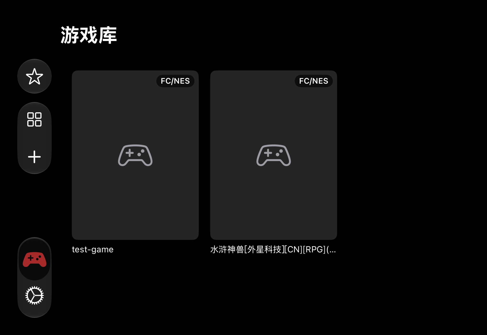
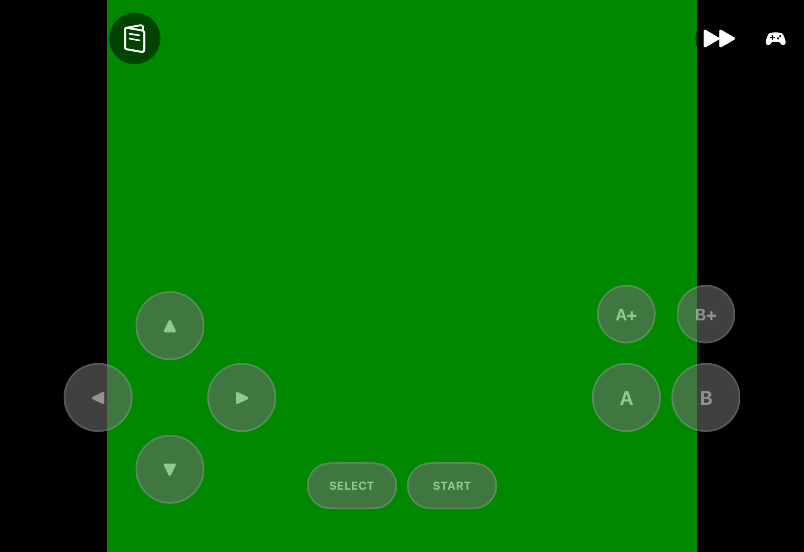

# MiniRetro · 小霸王复古模拟器

[](LICENSE)


一款面向 iPhone / iPad 的复古游戏模拟器：**SwiftUI + Metal** 自绘前端，**libretro** 内核驱动，
支持 FC/NES、GB/GBC、GBA 以及街机（CPS1 / CPS2 / Neo Geo / PGM）。

侧载安装（自签名 ipa），不上 App Store。**仓库不含任何 ROM / BIOS**，游戏数据由使用者自行导入。

| 游戏库 | 游戏内 |
|---|---|
|  |  |

---

## 支持的平台

| 平台 | 扩展名 | 内核 | 备注 |
|---|---|---|---|
| FC / NES | `.nes` `.unf` `.unif` | fceumm | 含早期汉化卡带的 UNIF 封装 |
| Famicom Disk System | `.fds` | fceumm | |
| Game Boy / Color | `.gb` `.gbc` | SameBoy | 原生 cheats 支持（构建期打补丁） |
| Game Boy Advance | `.gba` | mGBA | |
| 街机 | `.zip` `.7z` | FBNeo（可选） | CPS1/CPS2/Neo Geo/PGM，需自备 BIOS |

街机游戏（三国战纪、西游释厄传、拳皇等）需要整套 romset **原样导入**（不要解压），
并把 `neogeo.zip` / `pgm.zip` 用同一个导入按钮装到 `System/` 目录——App 会自动识别。
FBNeo 产物较大（49 MB/切片）未入库，首次构建会自动从上游浅克隆并编译。

---

## 特性

- **虚拟按键**：左右分区 + 短边归一化坐标，iPad 4:3 与 iPhone 2.17:1 都保持对称与等间距；
  全键位可拖动、可调透明度，布局按「系统 + 皮肤」持久化
- **连发键**（A+/B+）与可调连发频率
- **快进**：2× / 3× / 4× / 6× / 8× / 16×，快进时音频按倍率抽取，不静音也不爆音
- **即时存档**：1 个自动槽 + 3 个手动槽，每槽保存当时的游戏画面作为封面；进游戏自动续上次进度
- **金手指**：本地录入 + **社区库一键查找**（内置 5000+ 条游戏索引，离线搜索，命中后下载代码）
- **蓝牙手柄**：Xbox / PS / 标准 MFi 手柄，键位可重映射；方向可用十字键或左摇杆
- **画面**：保持原始宽高比（aspect-fit）或全屏拉伸；像素 / 平滑 / CRT / LCD 四种滤镜（Metal 运行时编译）
- **中文与街机之外的细节**：中文 ROM 名识别、`-MRShowMenu` 等自动化验证入口

---

## 构建

需要 macOS + Xcode 16 以上（开发验证于 Xcode 27.1 / iOS 27 SDK）。

```bash
# 依赖（一次）
brew install xcodegen cmake rgbds

# 一键：四个 core → xcframework → xcodebuild → 未签名 ipa
./Tools/build.sh

# 产物
#   build/MiniRetro-<版本>-<build>-unsigned.ipa
```

| 参数 | 作用 |
|---|---|
| `--skip-cores` | 跳过内核编译（xcframework 已存在时加速；FBNeo 缺失会自动补建） |
| `--adhoc` | 使用 ad-hoc 签名（部分签名工具不接受完全未签名 ipa） |
| `MR_CLEAN_BUILD_DIR=1` | 彻底清空派生数据后重建 |

只用某个内核：

```bash
./Cores/build_cores.sh fbneo        # 也可 mgba / sameboy / fceumm
```

### 不需要设备的自检

```bash
./Tools/run_romlib_test.sh   # 28 项：ROM 识别 / 导入去重 / 脏索引自愈 / 街机 zip / 金手指解析
./Tools/run_e2e.sh           # macOS 端到端：真实加载 → 60fps → 抓帧 → 存档往返（三 core 各 15 项断言）
./Tools/run_simulator.sh     # 模拟器安装、启动、截图
```

---

## 安装（侧载）

**直接下载**：最新构建见 [Releases](https://github.com/xvzxv/MiniRetro/releases)
（未签名 ipa，仍需自行签名）。

仓库不内置签名脚本，签名由你自行管理：

1. 用 **Sideloadly / AltStore / 自签证书** 对 `build/*.ipa` 或 Release 附件签名
2. 免费 Apple ID 的签名 7 天过期，需重新签名
3. 签名工具拒绝未签名 ipa 时，改用 `./Tools/build.sh --adhoc`

---

## 使用

1. 右上角 `+` 导入 ROM；含主机 ROM 的 `.zip` 会自动解压并按平台分类
2. 点击卡片进入游戏（横屏）
3. 左上角菜单：存档槽位 / 金手指 / 快进 / 滤镜 / 布局编辑 / 手柄键位 / 软复位

**金手指**：菜单 → 金手指管理 → 「从社区金手指库查找」按游戏名搜索，勾选后一键导入并立即生效；
也可手动录入 Game Genie / GameShark / Action Replay / CodeBreaker 或 `地址:值` 内存写入码。

**存档**：退出游戏与进入后台都会写自动槽；手动槽可随时保存 / 读取 / 删除，删除同时清理文件。

---

## 架构

```
App (SwiftUI)  ──  UIKit/Metal 渲染、输入、状态
   │  ObjC bridging
CoreBridge     ──  C/ObjC++ 唯一内核入口（RetroCore / FramePipeline / AudioRingBuffer / CoreRegistry）
   │  dlopen
libretro core  ──  *.framework（fceumm / SameBoy / mGBA / FBNeo）
```

设计约束（改代码前请先读）：

- **只有 CoreBridge 能 `#import "libretro.h"`**，App 层不得直接调用内核
- `retro_run()` 只在专用串行线程调用；其余 libretro API 由互斥锁串行化
- 输入走「原子位掩码状态表」：虚拟按键 / 蓝牙手柄 → 位掩码 → `retro_input_state`
- 帧缓冲、纹理、环形缓冲预分配，run 循环内零逐帧分配
- 新系统 API 一律 `#available` 守卫；部署目标固定 17.0

```
App/              SwiftUI 源码（Library / Game / Settings / Models / Utilities）
CoreBridge/       C/ObjC++ 桥接层
Cores/
  mgba/ sameboy/ fceumm/   上游源码快照（版本锁定见 .gitmodules 头部说明）
  libretro.h               libretro API 头文件（固定版本）
  artifacts/               编译产物 xcframework（FBNeo 除外）
  build_cores.sh           交叉编译内核 → artifacts/*.xcframework
Tools/
  build.sh                 一键构建（core → xcframework → App → ipa）
  package_ipa.sh           打包未签名 ipa
  run_e2e.sh               macOS 端到端验证
  run_romlib_test.sh       游戏库逻辑回归测试
  run_simulator.sh         模拟器安装 / 启动 / 截图
  make_xcframework.sh      纯 shell 打包 xcframework（xcodebuild 不可用时的回退）
  gen_cheat_index.py       生成内置金手指索引
Tests/                    XCTest 与命令行回归测试
docs/                     架构决策（ADR）、维护指南、测试矩阵、进度日志、截图
```

---

## 文档

| 文档 | 内容 |
|---|---|
| [`docs/maintenance.md`](docs/maintenance.md) | 维护指南：目录职责、验证矩阵、发版清单、常见问题 |
| [`docs/adr-log.md`](docs/adr-log.md) | 架构决策记录（含每次实测踩坑与修正） |
| [`docs/testing.md`](docs/testing.md) | 测试用例表 |
| [`docs/progress-log.md`](docs/progress-log.md) | 版本进度日志 |

---

## 已知限制

- **不含 ROM**：仓库不提交任何有版权 ROM / BIOS；测试用 homebrew 作品请自行准备
- **街机**：只验证到内核编译与集成（无 romset/BIOS 无法实测运行）；不支持 CHD 镜像
- **街机金手指**：社区库不提供街机归档，只能手动录入
- **联机**：`specs/online-play-design.md` 仅为设计文档，未实现
- **签名**：仓库不承担签名 / 重签，只产出未签名 ipa

---

## 许可

- 本项目自有代码：**MIT**，见 [LICENSE](LICENSE)
- 第三方内核：fceumm（GPL-2.0）、SameBoy（Expat/MIT）、mGBA（MPL-2.0）、FBNeo（禁止商业使用）
  各自的许可证原文保留在 `Cores/` 对应目录，汇总见 [THIRD-PARTY-NOTICES.md](THIRD-PARTY-NOTICES.md)

再分发二进制时请同时满足上述许可证条款。**请勿将本仓库用于任何商业用途的街机内核分发。**

## 致谢

[fceumm](https://github.com/libretro/libretro-fceumm) · [SameBoy](https://github.com/LIJI32/SameBoy) ·
[mGBA](https://github.com/mgba-emu/mgba) · [FBNeo](https://github.com/libretro/fbneo) ·
[libretro](https://www.libretro.com/) · [XcodeGen](https://github.com/yonaskolb/XcodeGen)
